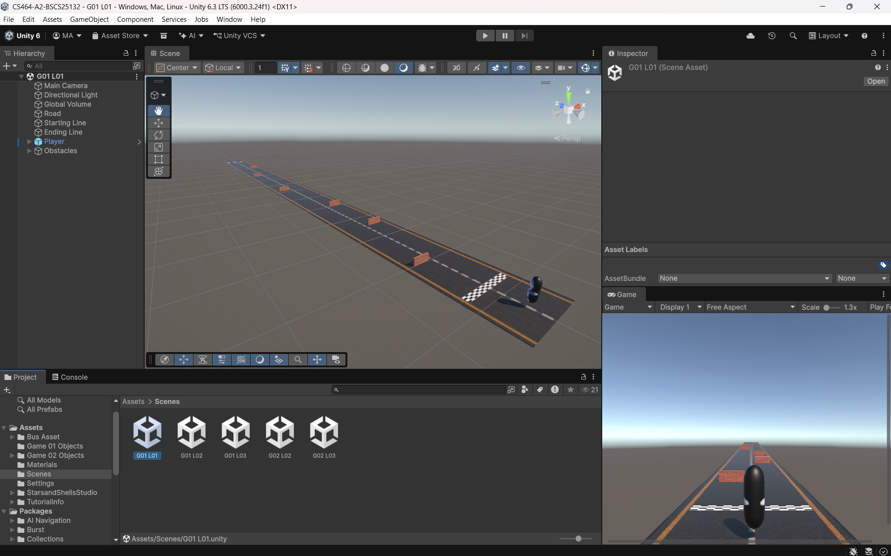
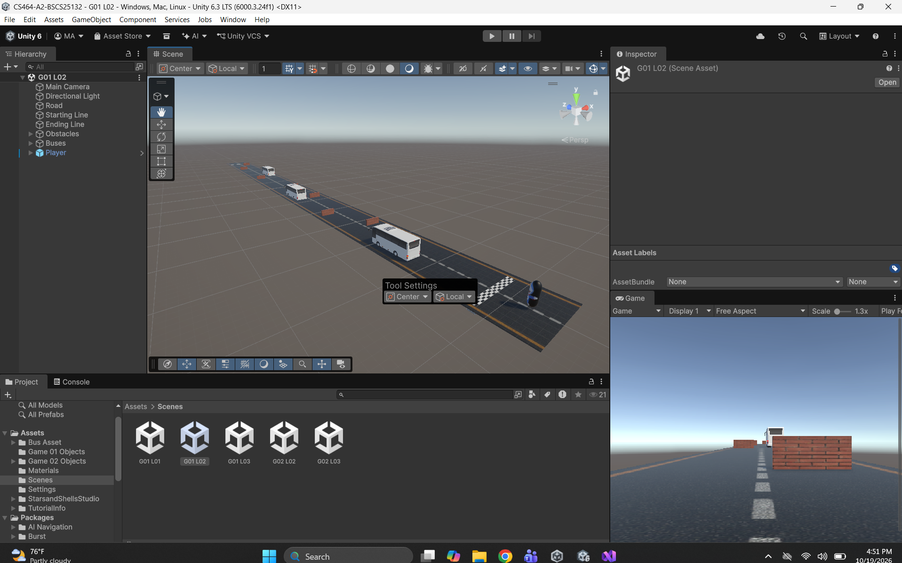
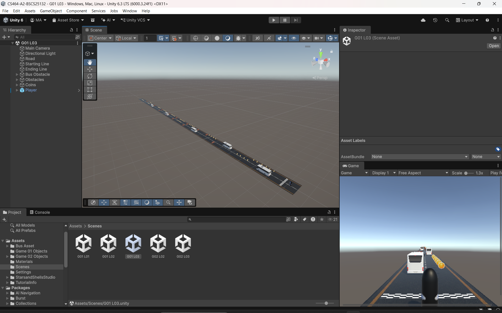
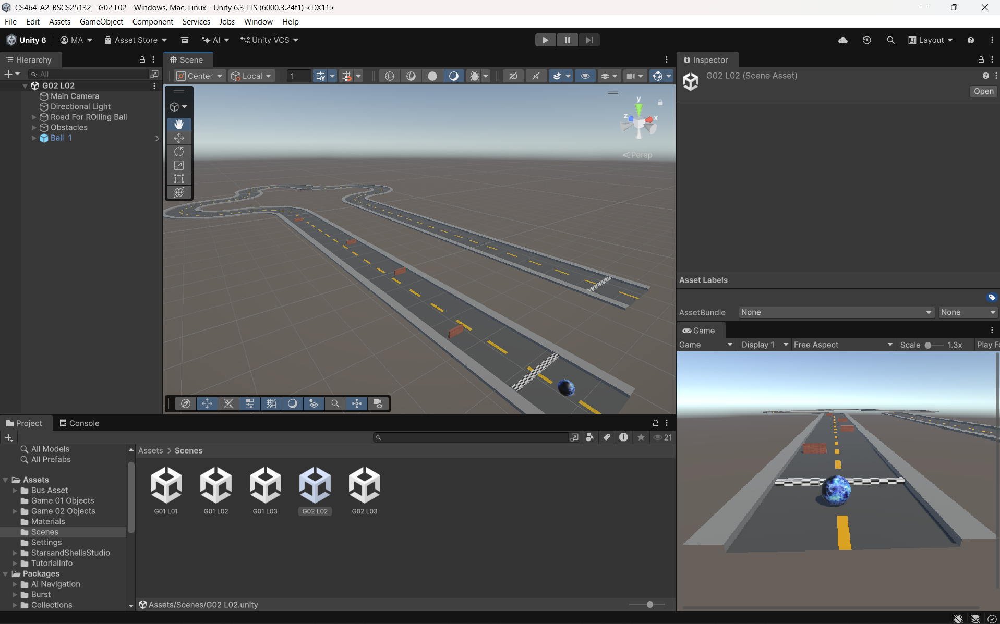
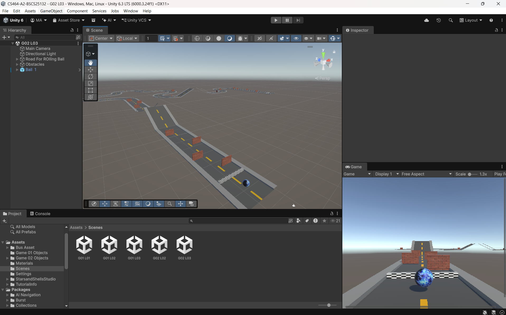

# CS464-A2-BSCS25132

# Assignment 02

Name: Muhammad Abdullah
Roll no: BSCS-25132
Course: CS464 Game Development

## What I Built
- Two player prefabs: `Player` (3 runner levels) and `BallPlayer` (2 rolling ball levels).
- Input is read in `Update`, and movement happens in `FixedUpdate` with physics. Movement is relative to the camera.
- The ground check uses the contact normal: a surface pointing up means the ball is standing on it.
- The jump reaches a set height in metres, with coyote time, a jump buffer and extra gravity when falling.
- One juice effect: a landing squash, run by a coroutine with a smoothstep easing curve.
- `CameraFollow` runs in `LateUpdate` with `SmoothDamp` and look-ahead. In ball levels it also turns behind the ball on curved tracks.
- The runner speeds up over time, and each level has its own speed values.

---

## Level 1 (Runner)
**What this level asks:** The level has a very small track for runner which include a little obstacles.

**Screenshot:**

&nbsp;

&nbsp;

&nbsp;

**Video link:** https://drive.google.com/file/d/1Mn0ijOvoCQwpzA5eUeQb-yI9jRmDyTAc/view?usp=sharing 

---

## Level 2 (Runner)
**What this level asks:** This level is little bigger than level 1 and have one more type of obstacle.

**Screenshot:**

&nbsp;

&nbsp;

&nbsp;

**Video link:** https://drive.google.com/file/d/1EodPJ1muh74G592G_h1cKOy8kQY90C-Z/view?usp=sharing

---

## Level 3 (Runner)
**What this level asks:** This is the level 3 for the game which have multiple obstacles, longer track then level 1 & level 2 and also have coins to engage player.

**Screenshot:**

&nbsp;

&nbsp;

&nbsp;

**Video link:** https://drive.google.com/file/d/1lSWUUp51IfDqlBGlwXtbxiRUrD1oPc0A/view?usp=sharing

---

## Level 4 (Rolling Ball)
**What this level asks:** This is the rolling ball level include curly track and obstacles which our ball have to pass in order to complete the level.

**Screenshot:**

&nbsp;

&nbsp;

&nbsp;

**Video link:** https://drive.google.com/file/d/1TCX_aijohFEAnffJhJZ3nQLmZtImVQfS/view?usp=sharing 

---

## Level 5 (Rolling Ball)
**What this level asks:** This is the last level of our rolling ball game which have slopy, curly, gapped track (ball has to jump here to pass) and multiple obstacle walls that our ball has to pass for level completion.

**Screenshot:**

&nbsp;

&nbsp;

&nbsp;

**Video link:** https://drive.google.com/file/d/1Lj6QNAJh-9_6J9S6aUyiNm1ZtUdXcyu8/view?usp=sharing

---
